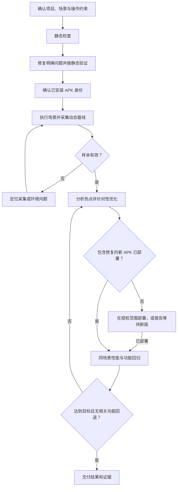

# Android Performance Workflow

一个可复用的 AI Agent Skill，用于 Android App 的性能检查、修复和回归验证。

**静态分析发现问题并修复；动态分析定位热点并优化；在同一场景回归，确认性能与功能。**

适用于 Jetpack Compose、View/XML 和混合项目，不绑定特定 App、包名、SDK 路径或设备。它是一套社区维护的工作流，调用使用者安装的官方 Android skills，并非 Google 官方产品。

## 能做什么

| 阶段 | 主要工作 | 交付结果 |
| --- | --- | --- |
| 静态检查 | 检查状态更新、布局测量、预取、图片加载、主线程工作与生命周期 | 有代码依据的问题和优化候选 |
| 静态修复 | 在指定范围减少重复工作，保留现有功能和交互 | 修改代码、静态验证和待测假设 |
| 动态分析 | 在真机或模拟器执行场景、采集 trace、验证样本有效性 | 与实际操作对应的性能证据 |
| 针对性优化 | 根据 CPU、布局、渲染、等待或内存证据处理热点 | 可解释、可回归的改动 |
| 回归验证 | 确认新版 APK 已部署，复用场景比较并检查功能 | 前后结果、波动范围和未覆盖项 |

可以从任一阶段开始，不要求每次都重跑完整流程。只要求分析时，不会擅自修改业务代码。

## 工作流



静态修改后仍可采样旧 APK，但这只能作为旧版基线。只有包含修复的新版 APK 已部署，才能验证代码优化效果。连续出现相同采集失败时，应先排查原因，不无限重录。

## 前置条件

- 一个支持 `SKILL.md` 的 AI agent，能够读取项目文件、执行终端命令。不同 agent 的发现目录和调用语法以其文档为准。
- [Android CLI](https://developer.android.com/tools/agents/android-cli)，或已配置的官方 Android skills 插件。参见 [官方文档](https://developer.android.com/tools/agents/android-skills)和[官方仓库](https://github.com/android/skills)。
- 动态分析需要 Android SDK platform-tools、已授权的真机或模拟器，以及可运行的目标 App。具体数据源、工具和系统版本要求以官方 profiler skill 为准。

仅静态检查不需要连接设备。本仓库本身是 Markdown 工作流，没有执行脚本，也不打包 Android SDK、官方 skills 或 Perfetto 二进制；下游工具可能有自己的运行依赖。

## 安装

### 1. 安装本 skill

下载或 clone 本仓库，将包含 `SKILL.md` 的整个目录放入 agent 的技能发现目录，保留 `references/` 子目录。

例如，Codex 用户的全局安装位置为：

```text
${CODEX_HOME:-$HOME/.codex}/skills/android-performance-workflow/
```

其他 agent 使用各自支持的目录；也可以按 agent 的规则进行项目级安装。目标目录已存在时，先比较内容，避免覆盖定制版本。安装后按 agent 的要求刷新技能或开启新会话。

本 skill 不依赖其他个人 skill，不会在安装时修改全局配置、构建项目或操作设备。

### 2. 发现并安装官方 Android skills

先查看当前 Android CLI 的帮助和目录：

```sh
android skills --help
android skills list --long
android skills find performance
android skills find compose
android skills add --help
```

确认当前 CLI 支持以下参数后，Codex 用户可以安装：

```sh
android skills add --agent=codex android-profiler
android skills add --agent=codex jetpack-compose-performance
```

其他 agent 应使用 CLI 支持的对应名称。项目级安装按当前帮助使用 `--project` 参数。View/XML 项目不必安装 Compose 专项技能。

这里的 `android skills` 属于 Android CLI，不是旧版 Android SDK 的 `android` 命令。技能安装完成后，agent 需要读取其 `SKILL.md` 并执行工作流；本项目没有 `android skills run` 命令。

## 使用示例

将请求交给 agent。以下 `$android-performance-workflow` 是显式调用示例，具体语法取决于 agent。

### 静态检查与修复，暂不编译

```text
使用 $android-performance-workflow 检查首页展开和图片列表滚动的性能。
先做静态分析并修复有明确代码依据的问题，保留现有功能，暂时不要编译。
```

### 对已安装 App 做动态分析

```text
使用 $android-performance-workflow 分析已连接设备上的 App。
目标是冷启动、列表滚动、停滚静置和后台恢复。
使用现有 APK，先记录版本身份，自动操作并采集有效 trace，不编译、不修改代码。
```

### 用户手动操作设备

```text
设备不支持自动触摸注入。使用 $android-performance-workflow 准备录制，
等我确认目标页面就绪，再开始采集并告诉我分段操作步骤。
```

### 根据分析结果优化

```text
根据上一轮有效 trace，优化已经确认的布局和主线程热点。
保留功能和交互，避免同时大范围重写，暂不编译。
完成后说明哪些问题已修复，哪些还需要新版 APK 验证。
```

### 部署新版后回归

```text
包含修复的 APK 已安装到同一设备。
使用 $android-performance-workflow 核对版本，按之前同一场景做性能与功能回归。
比较相同口径的数据，并记录样本波动和未覆盖项。
```

### 授权完整闭环

```text
使用 $android-performance-workflow 完成指定列表的性能优化。
允许构建调试 APK，并安装到指定测试模拟器进行功能回归。
保留应用数据，发布版性能基准另行安排。
```

## 默认行为与验证边界

- **默认不编译、不重装。** 可在具体任务中明确授权；已经授权的操作不重复确认。
- **保留现有功能。** 不通过隐藏入口、删减内容、停掉必要动画或绕过权限来换取性能指标。
- **确认操作确实发生。** 错页、没有实际滚动、读取旧 UI 文件或目标阶段被 trace 缓冲覆盖的样本，不算有效回归。
- **区分计算与等待。** 墙钟耗时不等于 CPU 耗时，后台 GC 总时长不等于 UI 暂停，渲染长等待不自动等于图片解码慢。
- **保持对照条件。** 使用相同设备、构建类型、素材、初始状态和操作脚本，记录改变的条件与样本波动。
- **区分诊断和基准。** Debug APK、JIT 与模拟器数据可用于定性定位，但不能直接当作发布版真机表现。
- **不夸大完成度。** 未部署新版时报告“静态修复完成，动态回归待新版”；短时内存增长不能直接证明泄漏。

项目本身的协作规则、当前用户约束和工具权限仍然适用。

## 输出内容

报告保存到目标项目约定位置，包含：

1. 测试对象、APK 身份、设备和实际执行的场景。
2. 静态发现、动态证据、推断及尚缺证据。
3. 修改内容及其功能影响。
4. 同口径前后数据、异常样本排除原因和功能回归结果。
5. 已执行与未执行的验证，以及 trace、配置、事件记录和可复现查询的位置。

本仓库不附带某个 App 的性能分数，也不承诺固定百分比收益。实际效果需要在目标项目上测量。

## 仓库结构

```text
android-performance-workflow/
├── SKILL.md
├── README.md
├── VALIDATION.md
├── LICENSE
└── references/
    └── recording-and-regression.md
```

- [SKILL.md](SKILL.md)：agent 的工作流入口。
- [录制与回归规则](references/recording-and-regression.md)：采样有效性、统计口径和对照要求。
- [VALIDATION.md](VALIDATION.md)：维护者的结构检查与行为验收案例。案例是验收要求，不代表所有 agent 都已验证通过。


## 许可证与上游

本仓库原创内容采用 [MIT License](LICENSE)。官方 Android skills 及其调用的工具保留各自许可证；本仓库仅链接并编排使用它们，不重新分发其实现。
